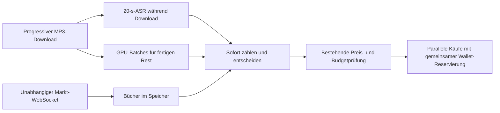

# All-In Mentions: Umsetzung und Offline-Messung, 10.10.2026

Auftrag: die Latenz nach dem Drop senken, unnötige Blockaden entfernen und
CPU/GPU prüfen. Änderungen werden in operative und Entwicklungskopie übernommen.
Kein Bot oder Live-Handel wurde gestartet.

## Was früher geschah und was jetzt geschieht

Die Vorstellung «während des Downloads schon transkribieren, 20 s mit
Überlappung auswerten und bei erreichter Schwelle kaufen» war grundsätzlich
bereits richtig. Nach Download-Ende wechselte der Code aber auf den ganzen
offenen Rest. GPU-Batching war schneller im Durchsatz, doch eine vollständige
Liste hielt alle Ergebnisse bis zum Ende zurück.

Jetzt bleibt während des Downloads die 20-s-Verarbeitung mit 2-s-Überlappung.
Für den fertigen grossen Rest bleibt GPU-Batching erhalten. Jedes fertige
Segment wird sofort gezählt und kann eine Entscheidung auslösen. Die
Ausgabeabschnitte entsprechen dann ASR-Segmenten, nicht exakt 20 Sekunden.
«Treffer» bedeutet weiterhin: Marktregel, Konfidenz und gegebenenfalls
Zielsprecher passen; die notwendige Zählschwelle inklusive Puffer ist erreicht;
Preis, Budget und STOP erlauben den Kauf. Es wird nicht bei jedem erkannten
Wort blind gekauft.



RSS und YouTube laufen unabhängig vom direkten Prober. Ihre Wartezeiten halten
den schnellen Pfad nicht mehr auf. Nach dem Drop stoppen alle Quellen-Poller.
Ein kompletter Verzicht wäre wegen geänderter Dateinamen fragil: E288 wurde
mit `E288_AUDIO_v102.mp3` dokumentiert. Ein langsamerer Ersatz kann dann den
gesamten Ausfall vermeiden. Die bestehende Episodenprüfung bleibt erhalten.

Orderbücher werden vorab per öffentlichem WebSocket aufgebaut und laufend
aktualisiert. Buchaufzeichnung und Audioverarbeitung laufen unabhängig.
Im Bot-Lauf und seinen Sweeps gibt es keine synchronen REST-Buchabfragen mehr.
Bei Verbindungsausfall gibt es ohne frischen Snapshot keinen Kauf. Offene
Nachlaufkandidaten bleiben erhalten. SDK-Tokenmetadaten werden vorab gewärmt.

## Messung auf E292

Lokale unveränderte MP3: 5594,256 s, SHA256
`1fa87570b1c436e05da5513c482479332800bfce1d5d8dd40529a7800e603d2f`.
Hardware: RTX 3060 12 GB, i5-12400F, 16 GB RAM. faster-whisper 1.2.1,
CTranslate2 4.8.0. Dieselben bestehenden Modelle, keine Modelldownloads.

Zeiten beginnen bei warmer ASR. Download, Audio-Dekodierung, Modellladen,
Orderbücher und Orderausführung sind ausgeschlossen. Dekodierung benötigte
separat rund 7 bis 9 s. Je Variante ein Durchlauf; keine p95-Schätzung.

| Variante | Erstes Segment | Ganze ASR | Beobachtung |
|---|---:|---:|---|
| Bisher: GPU, vollständige Ergebnisliste | 44,44 s | 44,51 s | Alle Treffer erst am Schluss |
| Probe: GPU, nur 20-s-Aufträge | 0,66 s | 152,34 s | Zuckerberg 0 statt 1; andere Zählwerte verändert |
| Probe: GPU-Generator sofort weitergeben | 16,31 s | 43,33 s | Alle 13 Marktstände wie bisher |
| Eingebauter All-In-Pfad | 17,85 s | 45,73 s | Alle 13 Marktstände wie bisher |

| YES-Schwelle | Bisher | Eingebauter Pfad |
|---|---:|---:|
| Anthropic, inklusive bisherigem Puffer | 44,44 s | 18,91 s |
| Microsoft | 44,44 s | 22,41 s |
| Zuckerberg | 44,44 s | 27,17 s |
| AI, inklusive bisherigem Puffer | 44,44 s | 42,14 s |
| Hundred, inklusive bisherigem Puffer | 44,44 s | 45,71 s |

Der letzte Wert zeigt: Die Änderung hilft besonders früheren Wörtern. Sie
garantiert nicht, jeden Markt schneller zu erreichen. Identische Endstände
beziehen sich auf dieses Replay, nicht auf bewiesene Richtigkeit des Modells.
Die frühere reale E292-Latenz von rund 83 s bis zum ersten eigenen YES ist eine
andere Messstrecke und darf nicht direkt mit den ASR-Zahlen verglichen werden.
Ein Vorsprung gegenüber anderen Wallets wurde nicht nachgewiesen.

## CPU/GPU-Test

Begrenzter Ausschnitt: je 120 s vom Anfang, aus der Mitte und vom Ende,
zusammengesetzt zu 360 s. CPU-small int8, vier Threads; GPU-large-v3 float16.

| Prüfung | Zeit |
|---|---:|
| CPU-small allein | 80,22 s |
| GPU-large allein | 9,41 s |
| Beide nacheinander | 89,64 s |
| Beide gleichzeitig | 66,15 s |

Gleichzeitiger Betrieb funktioniert. In der Parallelmessung benötigten CPU und
GPU 66,14 beziehungsweise 10,03 s. Dass die CPU dabei auch allein schneller
wirkt als im ersten Durchlauf, ist kein belastbarer Beschleunigungsnachweis;
Wärme-, Cache- und Systemlast-Effekte sind nicht getrennt. CPU-small und
GPU-large zählten «hundred» 6 beziehungsweise 1. Das ist ein Grund gegen eine
ungeprüfte Zusammenführung. Der verkettete Ausschnitt validiert keine volle
NO-Entscheidung. Produktionspfad bleibt GPU, vorhandener CPU-Fallback bleibt.

## Nachauftrag: fortlaufend dekodieren und gleichzeitig kaufen

Chole autorisierte anschliessend ausdrücklich beide Änderungen. Der frühere
Hinweis «unverändert» bezog sich nur auf die MP3-Dekodierung: Bei jeder neuen
Dateigrösse wurde die Datei wieder von vorne in Audiosamples übersetzt. Der
Cache half nur, wenn zwischen zwei Aufrufen keine neuen Bytes angekommen waren.

Jetzt liest ein PyAV-Worker die wachsende MP3 einmal vorwärts. MP3- und
Resamplerzustand bleiben erhalten, neue Samples werden angehängt. Temporäres
Dateiende während Download bedeutet warten, nicht Episodenende. Erst nach
Download-Ende werden Decoder und Resampler vollständig geleert. ASR-Fenster,
Overlap und Wort-Dedup bleiben erhalten. Aktivierung ausschliesslich für die
All-In-Serie 11300; andere Aufrufer behalten die bisherigen Voreinstellungen.

Begrenzte Messung mit derselben E292-MP3, 134'265'006 Bytes:

| Dekodierung | Bisher | Jetzt |
|---|---:|---:|
| Zehn wachsende Dateistände, insgesamt | 58,97 s | 8,98 s |
| Einmal die vollständige Datei | 8,04 s | 7,40 s |
| Kumulierte komprimierte Dateibytes | 738'457'529 | 134'265'006 |

Der Gewinn über zehn Dateistände beträgt Faktor 6,57 für diesen Schritt.
Beide fertigen Audiovergleiche enthalten exakt 89'508'096 Samples, bitgleich
mit maximaler Abweichung 0. Auch die stabilen Präfixbereiche stimmen überein.
Ein lokaler Durchlauf mit Dateicache, keine p95-Messung. Download, GPU-ASR und
Orders sind hier nicht enthalten. Der kleine Decoder-FIFO hält bei 48 kHz
bis ungefähr 0,7 s Quellaudio zurück, zusätzlich zu Demux-Puffern. Das ist
keine entsprechend grosse Wallclock-Verzögerung bei schnellerem Dateidownload.

Vorher wartete der Hauptpfad während Käufen und Nachkäufen für Wort A.
Jetzt erhält jedes kaufbare Wort seinen eigenen Auftrag. Die Transkription
läuft weiter; Wort B kann bereits seine Order senden, während A noch auf die
Serverantwort wartet. Derselbe Markt erhält keinen zweiten gleichzeitigen
Auftrag. Ein Auftrag kauft mit FAK-Portionen weiter, solange aktuelle Asks
unter dem bestehenden Preisdeckel liegen, Mittel verfügbar sind und STOP
nicht aktiv ist. Nach einer verspäteten Bestätigung wird der Sweep fortgesetzt.

Für Live-All-In ersetzt das verfügbare Wallet den festen Gesamtbetrag
`MAX_USD_GESAMT`. `MAX_USD_PRO_MARKT` begrenzt weiterhin jede Orderportion,
nicht die gesamte Summe für dieses Wort. Der bisherige Gebührenpuffer von
3 % und die Mindestorder von 1 USD bleiben. Dadurch kann ein kleiner Rest
übrig bleiben. Die Reservierung gilt innerhalb dieses Bot-Prozesses.
Andere Programme dürfen nicht gleichzeitig mit demselben lokalen Budget
planen. Der Paper-Modus behält sein konfiguriertes simuliertes Budget.

Beispiel: Bei 100 USD und 50-USD-Portionen kann A 50 USD bestellen und B den
noch freien Betrag reservieren. Beide dürfen nicht unabhängig 100 USD
einsetzen. Bestätigte Ausgaben werden abgezogen; unklare POST-Antworten
behalten ihre Reservierung. Ein alter Wallet-Snapshot gibt ausgegebenes Geld
nicht wieder frei. Vor der ersten Ausgabe kann neu eingezahltes Guthaben
übernommen werden. Aufstockungen nach der ersten Ausgabe werden in diesem
Lauf konservativ nicht nach oben übernommen.

Orderbestätigungen werden ausserhalb der Audioverarbeitung im Abstand von
0,1 s geprüft, zuzüglich tatsächlicher Anfragezeit. Die Wallet-Abfrage bleibt
auf höchstens alle 5 s begrenzt. Ein fehlender Orderbeleg wird nicht als
Nullfüllung interpretiert. Bekannte Order-IDs können abgeglichen werden;
eine verlorene Antwort ohne ID bleibt für diesen Lauf gesperrt. Das vermeidet
doppelte Käufe, ist aber keine vollständige Recovery über Prozessneustarts.

Offline-Tests erzwingen, dass beide POST-Aufrufe schon laufen, bevor die erste
Antwort freigegeben wird. Weitere Regressionen prüfen gemeinsame Reservierung,
alte Wallet-Antworten, verlorene POST-Antwort, verspätete Teilfüllung mit
Fortsetzung, Bestätigung vor Worker-Ende, Nachlauf und STOP unmittelbar vor POST.
Es wurden keine echten Orders geschickt.

## Offene Punkte

- Jev: weiterhin offen, nicht integriert.
- SDK: ein öffentlicher Versionsabruf beim ersten Orderaufbau bleibt. Kein
  privater SDK-Cache wird manipuliert.
- Vollständige Recovery unklarer POSTs ohne Order-ID über einen Neustart bleibt
  offen. Konservative Preisdeckelschätzungen bei fehlenden Fill-Beträgen können
  verfügbares Restbudget unterschätzen.
- Echte Publikations-zu-Fill-Latenz und Vorsprung gegenüber anderen Wallets
  sind weiterhin nicht gemessen. Kein neues CPU/GPU-Ensemble eingebaut.

## Reproduktion und Evidenz

`operations.analysis.mentions_pipeline_benchmark` liest ausschliesslich lokale
Audio- und Snapshot-Dateien. Modi: `baseline`, `streamed`, `gpu`, `gpu20`,
`cpu20`, `hybrid`. `gpu` verwendet den eingebauten Transkriptor samt Wort-Dedup.

```powershell
python -m operations.analysis.mentions_pipeline_benchmark `
  --audio data/live/allin_live_1139524/episode.mp3 `
  --snapshot data/live/allin_live_1139524/gamma_event_snapshot.json `
  --mode gpu --output data/live/mentions_latency_benchmark_20261010/gpu.json
python -m pytest tests/test_mentions_pipeline_latency.py tests/test_pipeline_allin.py tests/test_no_konsens.py tests/test_mentions_latency.py -q
```

Messdateien stehen unter `docs/project/evidence/mentions_latency_20261010/`.
Der Nachauftrag ergänzt `decode_benchmark.json` und den reproduzierbaren Lauf:

```powershell
python -m operations.analysis.mentions_decode_benchmark `
  data/live/allin_live_1139524/episode.mp3 `
  --output data/live/mentions_concurrent_20261010/decode_benchmark.json
python -m pytest tests/test_incremental_audio.py tests/test_mentions_parallel_orders.py tests/test_mentions_pipeline_latency.py tests/test_pipeline_allin.py tests/test_trump_michigan_bot.py -q
```
Die öffentliche WS-Prüfung lieferte zwei vollständige Bücher nach 0,262 s;
beide Snapshots wurden validiert. Sie prüft keine Orders.

Ein unabhängiger Reviewer fand zwei Regressionen, beide korrigiert und getestet:
Legacy-Aufrufer benötigen einen vollständigen finalen Flush; ein fehlendes
Buch darf offene Nachlaufkandidaten nicht beenden. Kein blockierendes Finding
blieb übrig. Ponytail-Review: keine wesentliche unnötige Komplexität.

Prüfungen im isolierten Worktree:

- Fokussierte Regressionen: 111 bestanden, davon 12 neue Latenztests.
- Gesamtsuite: 1514 bestanden, 1 fehlgeschlagen. Ursache ist die bereits
  vorhandene Schema-3-Änderung in `basisraten.py`, während
  `test_basisraten_schwelle.py:215` noch Schema 2 erwartet. Diese fremde
  Änderung wurde nicht überschrieben. Einzelbestätigung: 25 bestanden,
  derselbe eine Fehler in den Basisratentests.
- Nach Übernahme in die Entwicklungskopie: **1565 bestanden** in 101,90 s.
  Deren vorhandener Basisratentest ist bereits auf Schema 3 angepasst.
  Die operative Kopie erhält keinen fremden Testfix; ihr Code entspricht
  für diese Änderung dem isoliert geprüften Stand.
- Ruff für alle sieben geänderten/neuen Python-Dateien: bestanden.
- `git diff --check` für die eigenen Codeänderungen: bestanden.
- Projekt-Review: vier vorhandene globale Beanstandungen bleiben:
  eingeschränkte Formulierungen in Monitor-Dateien, feste Whale-Schwelle,
  deferred ML gegen vorhandenen Speaker-Code, bestehende Live-Trading-Dateien.
  Kein pauschal grüner Repository-Status.
- `update_status` und `commit_plan` ausgeführt. Kein Live-Start, keine
  Orderplatzierung oder -stornierung. Der SDK-Test verwendet Mock-Antworten.

Intendant-Agenda war wegen HTTP 426/TLS-Konfiguration nicht erreichbar. Offene
Punkte sind deshalb hier dauerhaft festgehalten, ohne neue Terminserie.

Nachauftrag: Der unabhängige Reviewer bestätigte 28 Order-/Bot-Tests, ohne
verbleibendes Finding. Ruff und eigene Whitespace-Prüfung bestanden. Die
abschliessende Gesamtsuite wird unten und im Projektstatus festgehalten.
Die oben genannten ersten Gesamtsuite-Zahlen gehören zum vorausgehenden Stand.
Nullfüllungen behalten das bisherige Nachlaufintervall; bestätigte positive
Teilfüllungen setzen den Sweep sofort fort. Pending-Orders halten den Nachlauf
auch bei gleichzeitig zu teuren anderen Märkten für Bestätigungen offen.

Vorgeschlagener nächster Commit nur für diese Änderung:
`perf(mentions): decode growing audio once and parallelize wallet sweeps`.
Vorhandene Config-/Basisratenänderungen und fremde Statusabschnitte gehören
nicht in diesen Commit. Keine Änderungen gestaged, kein Push.


## Abschluss des Nachauftrags

- Finaler unveränderter Codestand in Entwicklung, operativer Kopie und Worktree.
- Entwicklung: **1588 bestanden in 105,90 s**, vollständige Suite.
- Operativ: **134 fokussierte Tests bestanden in 31,47 s**.
- Vorhandener operativer Basisratenfehler separat frisch bestätigt:12 bestanden,
  1 fehlgeschlagen. test_basisraten_schwelle.py:215 erwartet Schema2, der bereits
  zuvor geänderte Code liefert Schema3. Kein fremder Testfix übernommen.
- Ruff über zwölf eigene Python-Dateien und eigene Whitespace-Prüfung bestanden.
- Unabhängiges Review einschliesslich Paper-Budget-Ende: kein offenes Finding.
- Vier bekannte globale Review-Fehlergruppen bleiben, wie oben aufgeführt.
  review_check wurde mit begründet separat ausgeführten Tests aufgerufen.
- Graphify lokal aktualisiert:5574 Knoten,11274 Kanten; kein LLM-Lauf.
- update_status und commit_plan für beide Kopien ausgeführt. Keine Dateien
  gestaged, kein Commit/Push, kein Live-Start, keine echten Orders.

Prüfevidenz: followup_final_suite.txt, followup_operational_tests.txt und
followup_*_review.txt im Evidenzordner. Zwei ungeeignete Abschlussläufe wurden
nicht als Beleg verwendet: parallele Projektprüfer wiederholten Tests mit
gemeinsamem Temp-Verzeichnis; danach fehlte zunächst das Elternverzeichnis
eines isolierten Testpfads. Der oben genannte finale Lauf lief einzeln mit
vorhandenem Elternverzeichnis und endete erfolgreich.

Die erste Order und normale Folgekauf-Portionen laufen unabhängig von ASR.
Nach verzögerter Bestätigung wird eine Fortsetzung beim nächsten Ergebnisabruf
des Hauptloops eingereiht. Ein langer ASR-Aufruf kann genau diesen Folgeschritt
noch verzögern. Eine vollständig entkoppelte Wiederaufnahme wäre eine weitere
Latenzoptimierung; ein realer Zeitgewinn dafür wurde hier nicht gemessen.
